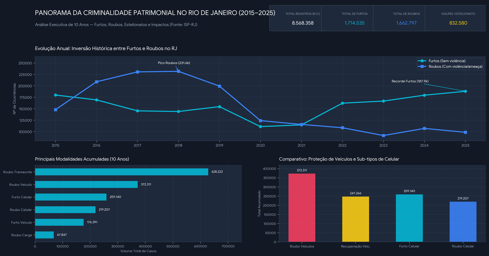

# 🔎 Painel da Criminalidade Patrimonial no Rio de Janeiro (2015 a 2025)


Projeto de Análise de Dados e visualização executiva dos registros de furtos, roubos e golpes/estelionatos no Estado do Rio de Janeiro entre 2015 e 2025, desenvolvido a partir das bases oficiais do ISP-RJ.

---

## 📸 Visual do Painel - Simples (Gemini)




## Visual do Painel (Interativo) - HTML/CSS/JS

- **Versão interativa no navegador (via GitHub Pages):** [Abrir Painel Interativo](https://matheusbarbosadados.github.io/portfolio-dados/1_mega_projetos/criminalidade_patrimonial/index.html)
- **Código do arquivo no repositório:** [Ver index.html](https://github.com/matheusbarbosadados/portfolio-dados/blob/main/1_mega_projetos/criminalidade_patrimonial/index.html)

---

## 🔗 Fonte dos Dados

Os dados foram obtidos no portal oficial de dados abertos do governo do Estado do Rio de Janeiro:

- **Portal:** [ISPdados - Estatísticas de Segurança Pública](https://www.ispdados.rj.gov.br/estatistica.html)
- **Base utilizada:** Série histórica mensal por município desde 2014 (`BaseMunicipioMensal.csv`), mantida pelo Instituto de Segurança Pública (ISP-RJ).

---

## 🧩 O que o Painel Mostra

- Cartões de KPI com o total geral de Registros de Ocorrência (8,56 milhões), total de furtos (1,71 milhão), total de roubos (1,66 milhão) e total de estelionatos (832,5 mil).
- Evolução anual (2015 a 2025) demonstrando a inversão histórica entre a queda continuada dos roubos violentos e o crescimento vertiginoso dos furtos sem violência.
- Detalhamento das 6 principais modalidades acumuladas no decênio (roubo a transeunte, roubo de veículo, furto de celular, roubo de celular, furto de veículo e roubo de carga).
- Comparativo operacional focado no balanço de roubos de veículos vs. veículos recuperados pela polícia (247,2 mil recuperados), além do desmembramento entre furtos e roubos de celular.

---

## 📂 Estrutura do Repositório

```text
1_mega_projetos/criminalidade_patrimonial/
├── BaseMunicipioMensal.csv     # Base oficial agregada do ISP-RJ (2014-2026)
├── analise_isp.py              # Script Python de carga, filtragem (2015-2025) e geração do resumo estatístico
├── resumo_isp_10anos.txt       # Arquivo compilado com a consolidação dos dados de 10 anos
├── Dashboard.png               # Imagem final do painel executivo em alta resolução
└── README.md                   # Documentação oficial do projeto
```
## 🤖 Transparência e Uso de IA Generativa

Este projeto utilizou o **Gemini** na abordagem 4ª Forma (No-Code / Processamento Generativo com IA):

**Extração e Consolidação via Python:** O script analise_isp.py foi usado para ler a base agregada do ISP-RJ, filtrar o recorte de 2015 a 2025 e gerar o resumo estatístico (resumo_isp_10anos.txt) sem travamentos.

**Geração Visual com o Gemini:** Os números consolidados foram processados com apoio do Gemini para estruturar e renderizar a imagem executiva final (Dashboard.png) em estilo escuro (Dark Tech), reunindo KPIs, evolução temporal e detalhamento por modalidade.

**Painel Interativo em HTML/CSS/JS:** Com os dados consolidados em mãos, o Gemini também apoiou a montagem do index.html com gráficos interativos e filtro multisseleção por ano.
