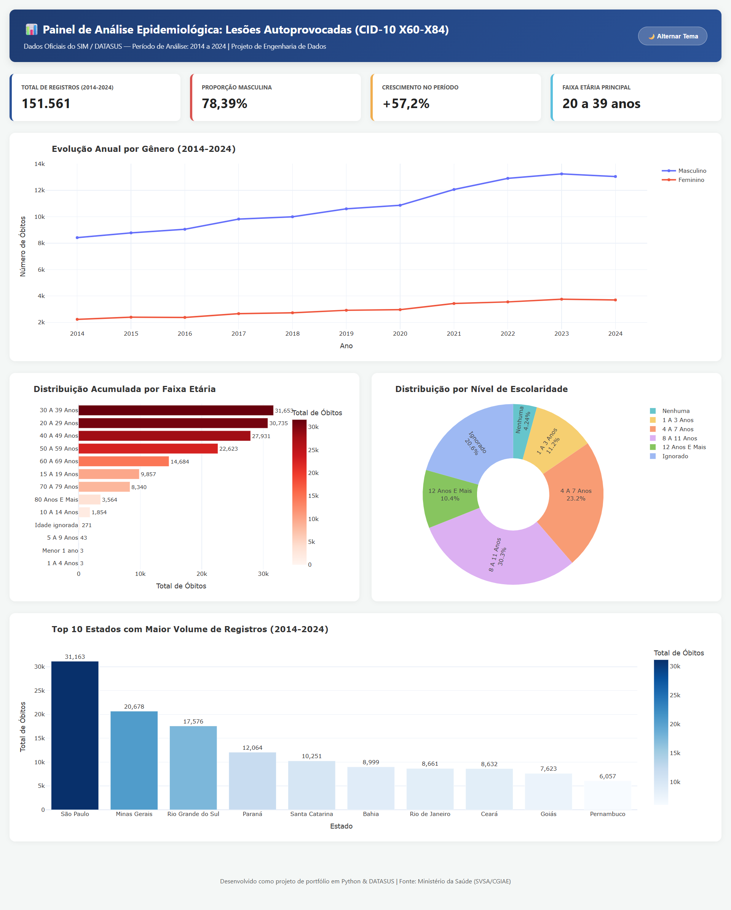

# 🎗️ Setembro Amarelo: Análise Epidemiológica da Mortalidade por Lesões Autoprovocadas no Brasil (2014–2024)

Este projeto foi desenvolvido em alinhamento com o **Setembro Amarelo**, campanha nacional de conscientização e prevenção do suicídio. Ele apresenta um pipeline completo de **Engenharia de Dados, Tratamento Relacional (ETL) e Visualização Interativa** sobre as estatísticas oficiais do Ministério da Saúde a respeito da mortalidade por lesões autoprovocadas (CID-10 X60 a X84) no Brasil.

A finalidade é analítica e educacional: usa exclusivamente dados públicos, anonimizados e agregados, sem identificar nenhuma pessoa e sem informações sobre meios ou métodos. O projeto está na pasta `1_mega_projetos/setembro_amarelo`, priorizando a transparência analítica e o rigor metodológico no tratamento de dados públicos de saúde.

---

## 🌐 Visualização do Dashboard

O painel foi desenvolvido em **Python** com a biblioteca **Plotly** e exportado como uma aplicação web estática e autônoma (`index.html`), equipada com **Modo Claro / Modo Escuro (Dark Mode)** e visualização responsiva.

* **Acesso Direto no Navegador:** Baixe o arquivo `index.html` da pasta e dê dois cliques para abrir o painel interativo localmente em qualquer navegador (Chrome, Edge, Firefox).
* **GitHub Pages (Visualização Online):** `https://matheusbarbosadados.github.io/portfolio-dados/1_mega_projetos/setembro_amarelo/index.html`

---

## 📌 Origem dos Dados & Metodologia

Os dados brutos foram extraídos da base pública do **Sistema de Informações sobre Mortalidade (SIM)**, mantido pela Secretaria de Vigilância em Saúde e Ambiente (SVSA) do Ministério da Saúde.

### 🔗 Links Oficiais de Acesso
* **Portal de Transparência da SVSA/MS:** [gov.br/saude/mortalidade](https://www.gov.br/saude/pt-br/acesso-a-informacao/sic/dados-em-transparencia-ativa/svsa/mortalidade)
* **Ferramenta de Tabulação TabNet:** [TabNet DATASUS (SIM - CID-10)](https://tabnet.datasus.gov.br/cgi/deftohtm.exe?sim/cnv/obt10uf.def)

### 📝 Parâmetros Utilizados na Extração (TabNet)
1. **Opção de Sistema:** `Mortalidade Geral` (óbitos por residência).
2. **Seleção de Variáveis:**
   * **Linha:** `Unidade da Federação`, `Sexo`, `Faixa Etária`, `Escolaridade`, `Estado civil` e `Cor/raça`.
   * **Coluna:** `Ano do Óbito` (seleção múltipla via `Ctrl` cobrindo o período de **2014 a 2024**).
   * **Conteúdo:** `Óbitos p/Residência`.
3. **Filtro da Causa da Morte (CID-10):**
   * Na caixa **Categoria CID-10**, selecionou-se a faixa **X60 a X84** (*Lesões autoprovocadas voluntariamente*).
4. **Exportação:** Arquivos gerados em texto delimitado por ponto e vírgula (`;`) e salvos no formato `.csv`.

---

## 🛠️ Engenharia de Dados & Parceria com Inteligência Artificial

O fluxo de trabalho reuniu boas práticas de engenharia de dados com o suporte analítico da Inteligência Artificial para a automação de etapas críticas:

1. **Higienização Inicial (`1_dados_brutos` → `2_dados_limpos`):**
   * Tratamento de encodings (`UTF-8` / `ANSI`) para preservação da acentuação em nomes de estados e categorias sociodemográficas.
   * Remoção de metadados institucionais, cabeçalhos de sistema e notas de rodapé do DATASUS.

2. **Modelagem Relacional e Unpivot (`2_dados_limpos` → `3_dados_tratados`):**
   * Desenvolvimento do script `2_tratamento_etl.py` com interface gráfica via **Tkinter** para seleção dos arquivos locais.
   * Aplicação da transformação `melt` (unpivot) com **Pandas**, convertendo as matrizes tabulares originais (anos nas colunas) em uma estrutura de dados relacional longa (`dimensao`, `ano`, `obitos`).
   * Isolamento de linhas de regiões e totais para prevenir duplicidade de contagem nas agregações de Business Intelligence.

3. **Construção do Dashboard (`3_gerar_dashboard.py`):**
   * Script Python responsável por ler os dados tratados, consolidar métricas de KPI e estruturar dinamicamente os gráficos interativos do Plotly em uma interface HTML com alternância de tema gráfico em tempo real (Light/Dark).

---

[](https://matheusbarbosadados.github.io/portfolio-dados/1_mega_projetos/setembro_amarelo/index.html)
- **Versão interativa no navegador (via GitHub Pages):** [Abrir Painel Interativo](https://matheusbarbosadados.github.io/portfolio-dados/1_mega_projetos/setembro_amarelo/index.html)
> 💡 *Clique no link acima para abrir a versão interativa do dashboard com filtros e gráficos dinâmicos.*

---

## 📈 Principais Conclusões Epidemiológicas (2014–2024)

* **Volume Acumulado:** O Brasil registrou **151.561 óbitos** decorrentes de lesões autoprovocadas no período consolidado de 2014 a 2024.
* **Tendência Temporal:** Houve um crescimento contínuo nos registros anuais, passando de **10.653 óbitos (2014)** para **16.751 óbitos (2024)** — uma elevação acumulada de **+57,24%** no período.
* **Proporção por Gênero:** Homens correspondem a **78,39% (118.807 óbitos)** do total nacional, enquanto mulheres representam **21,59% (32.725 óbitos)**, mantendo uma razão aproximada de 4 óbitos masculinos para cada feminino.
* **Faixas Etárias de Maior Risco:** A população jovem-adulta de **20 a 39 anos** concentra o maior volume absoluto de casos (**62.388 óbitos**, equivalentes a **41,16%** do total do país).
* **Escolaridade:** A maior incidência concentrou-se no grupo com **8 a 11 anos de estudo** (correspondente ao Ensino Fundamental II e Ensino Médio completo/incompleto).

> 💛 Por trás de cada número há uma vida e uma família. Os dados são apresentados com respeito e com o objetivo de dar visibilidade ao tema, apoiando a conscientização do Setembro Amarelo.

---

## 📁 Estrutura da Pasta do Projeto

```text
1_mega_projetos/setembro_amarelo/
├── 1_dados_brutos/          # Arquivos CSV originais extraídos do TabNet
├── 2_dados_limpos/          # Tabelas em formato de matriz limpa
├── 3_dados_tratados/        # Arquivos relacionais unpivoted (prontos para BI/SQL)
├── 1_tratamento.py          # Script de tratamento da base regional de UFs
├── 2_tratamento_etl.py      # Pipeline ETL dinâmico com seleção via Tkinter
├── 3_gerar_dashboard.py     # Script gerador do dashboard interativo HTML
├── index.html               # Aplicação web estática com o painel final
└── README.md                # Documentação técnica do projeto
```
