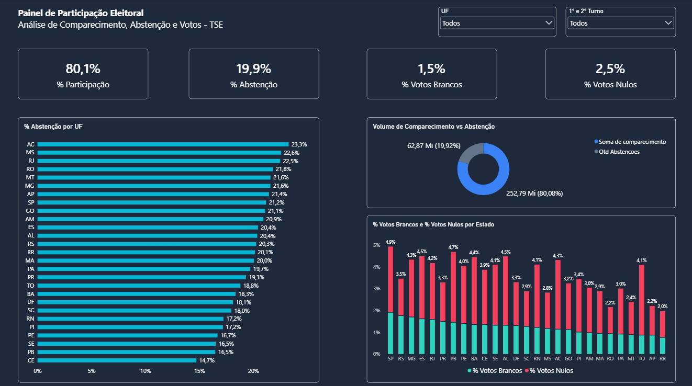

# 📊 Dashboard de Participação Eleitoral - TSE


Projeto completo de Análise de Dados e Business Intelligence (BI) focado na extração, tratamento, carga e visualização executiva da participação eleitoral (comparecimento, abstenções, votos brancos e nulos) com base nos dados públicos do Tribunal Superior Eleitoral (TSE).

---

## 📸 Visual do Dashboard



---

## 🔗 Fonte dos Dados

Os dados brutos utilizados neste projeto foram obtidos diretamente no portal oficial de Dados Abertos do TSE:

* **Conjunto de dados:** [TSE - Resultados 2026](https://dadosabertos.tse.jus.br/pt_BR/dataset/resultados-2026)
* **Recurso utilizado:** [Detalhe da Apuração por Município e Zona (CSV)](https://dadosabertos.tse.jus.br/pt_BR/dataset/resultados-2026/resource/b255886a-23f5-462f-8385-b2df4c3ddac3)

---

## 📂 Estrutura do Repositório

```text
.
├── 01_dados_brutos/        # Arquivos CSV originais baixados do portal do TSE
├── 02_dados_limpos/        # Arquivos CSV processados e prontos para carga
├── 03_sql/                 # Scripts SQL (criação de tabelas e views no MySQL)
├── 04_power_bi/            # Arquivo .pbix e imagem exportada do painel
├── 01_limpar.py            # Script Python para extração, limpeza e padronização dos dados
├── 02_carregar.py          # Script Python para ingestão automatizada no banco MySQL
└── README.md               # Documentação completa do projeto
