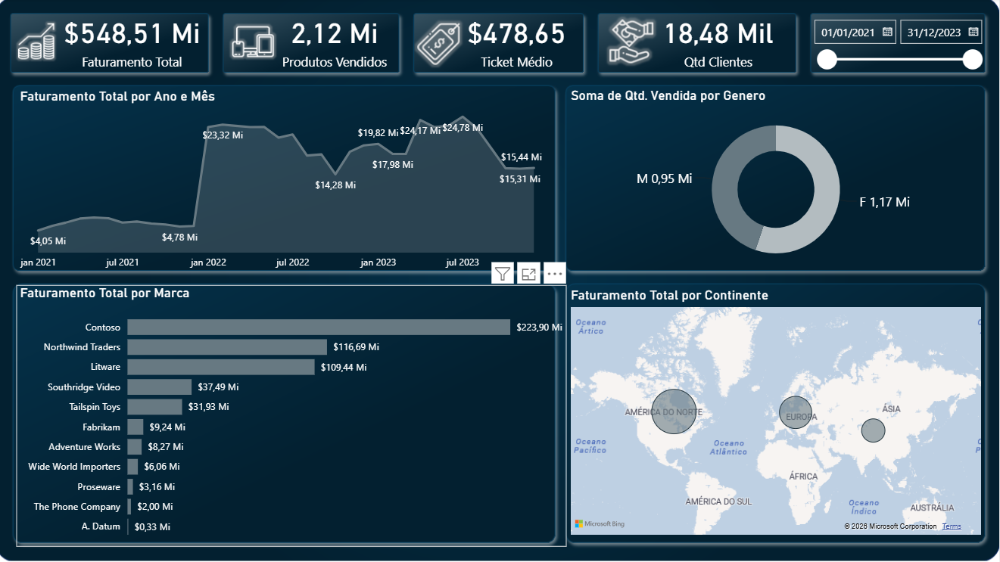
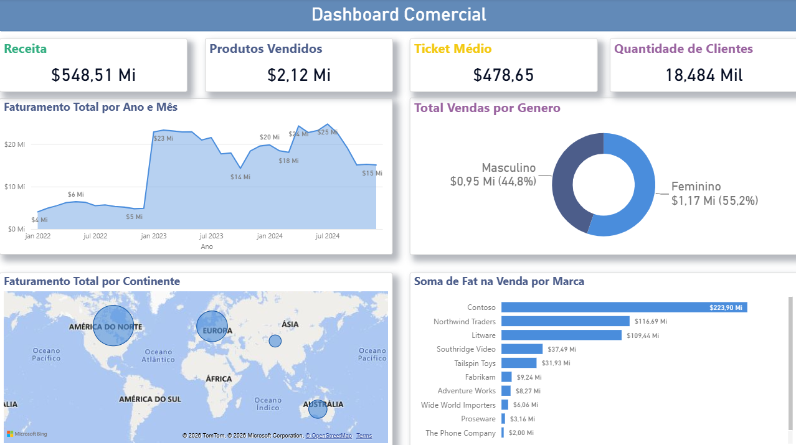
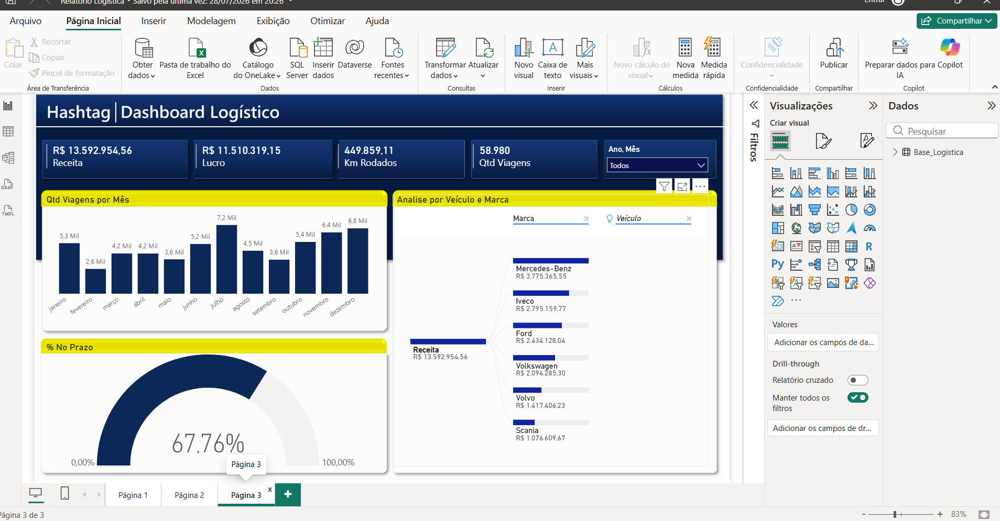
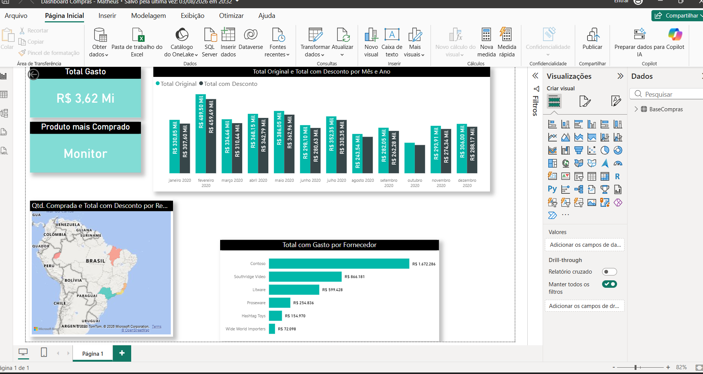
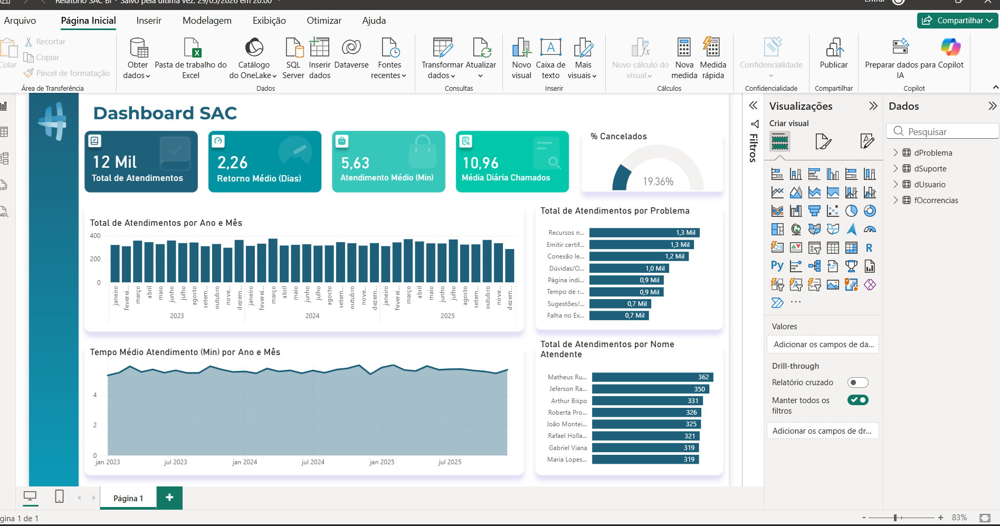

# Power BI - Dashboards

Cinco dashboards que fiz acompanhando as aulas do canal Hashtag Treinamentos, no YouTube.

## Como foram feitos

- Segui os mesmos passos das aulas.
- As cores e o layout de cada dashboard são escolhas minhas.
- As bases de dados e os arquivos do Power BI são do curso. Por isso, não estão neste repositório. Aqui estão só as imagens do resultado.
- São trabalhos de estudo, e não projetos profissionais.

## 1. Vendas (lojas, clientes e produtos)

[Aula no YouTube](https://www.youtube.com/watch?v=Vh6FS-pqjsM&list=PLccwYcBNyMAk1LsQ6opdZZW237qxusJw5&index=3)

## 2. Vendas (outros dados e outro layout)

[Aula no YouTube](https://www.youtube.com/watch?v=37oxzq2pSbI&list=PLxjKFMYkZ9OdI5b7egO3t5xFbTUhuw-vE&index=6)

## 3. Logística

[Aula no YouTube](https://www.youtube.com/watch?v=VMSfIaiW54M&list=PLxjKFMYkZ9Ocwz4qywOc5qYLi6apNZlCw)

## 4. Compras

[Aula no YouTube](https://www.youtube.com/watch?v=NW1t0JN8068&list=PLccwYcBNyMAk1LsQ6opdZZW237qxusJw5&index=1)

## 5. Atendimento ao cliente (SAC)

[Aula no YouTube](https://www.youtube.com/watch?v=7cUrsltJbEI&list=PLccwYcBNyMAk1LsQ6opdZZW237qxusJw5&index=2)
